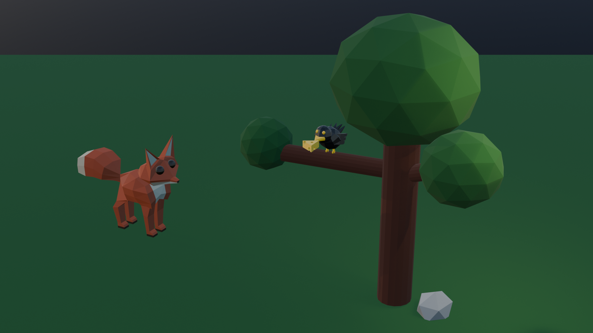

# Le Corbeau et le Renard

A short 3D animation of La Fontaine's fable _Le Corbeau et le Renard_ (The Crow and the Fox), modelled, rigged and animated in Blender.

[](https://youtu.be/LKRVYeGxHF0)

▶️ [Watch the animation on YouTube](https://youtu.be/LKRVYeGxHF0) (19 s)

## Requirements

- [Blender 5.2](https://www.blender.org/download/)
- [Git LFS](https://git-lfs.com/), since the `.blend` files are stored with LFS

## Project Layout

```text
le-corbeau-et-le-renard
├── animation
│   ├── animation.blend   final scene: characters, camera pan, title and fades
│   └── animation.mp4     final render
└── models                cheese, crow, fox and tree models, with a render of each
```

## Rendering

```bash
git lfs install
git clone https://github.com/attaulhaleem/le-corbeau-et-le-renard.git
```

Open `animation/animation.blend` and choose _Render > Render Animation_. The scene runs for 462 frames at 24 fps with EEVEE.
